# Module 3 — Raast P2M Issuing: An Overview

Read [Module 1 — Raast P2P Payment](../01-p2p/01_Raast_P2P_Payment_Overview.md) first. That module is one person paying another person. This module is the Customer Service Provider: the customer's bank paying a merchant.

The customer's bank places the hold and later confirms the debit. Paysys posts the payment to Raast. The merchant's bank is covered in [P2M Acquiring](../04-p2m-acquiring/04_Raast_P2M_Acquiring_Overview.md).

A scanned QR that belongs to a person follows Module 1. A merchant QR stays in this module.

P2M has four flows. The customer bank does not treat them as one payment.

| Flow | How it starts | Alias inquiry | What the customer bank waits for |
|---|---|---|---|
| Pay by Alias | The customer enters the merchant Raast ID | Yes. Raast resolves the merchant before the customer confirms | The merchant bank answers `pacs.008` with `pacs.002/AUTH`. Raast then sends `pacs.002/ACSP` |
| Static QR | The customer scans a merchant QR | No. The QR already carries the merchant | Same as pay by alias: `pacs.002/AUTH`, then `pacs.002/ACSP` |
| Dynamic QR | The merchant has already raised a request to pay, and the customer scans that QR | No | Raast checks that request. It answers the customer bank with `pacs.002/ACSP`. The `pacs.008` the merchant side receives is an advice to credit |
| RTP, now or later | The merchant asks the customer to pay | No merchant alias inquiry | The money moves when the customer pays. Raast checks that payment against the request, the same way as a dynamic QR |

## Learning objectives

By the end of this module, a new technical employee should be able to:

- Name the four P2M flows and say which one uses a merchant alias inquiry.
- Describe a static QR or pay-by-alias payment, from the hold to the merchant bank's `pacs.002/AUTH`.
- Describe a dynamic QR, including why `pacs.008` is an advice on the merchant side.
- Describe a request to pay, including pay now and pay later.
- Explain a rejection, a customer's request for a return, and the inquiry used when the result is missing.

---

## 1. What this module adds

The customer starts the payment, or the merchant asks the customer to pay. Either way, the customer's bank is the issuer. It checks the customer, holds the money, and confirms the debit only after Raast accepts the payment.

Paysys is the Open Connect service between that bank and Raast.

> **Finding the merchant answers: “Who is being paid?”**  
> **The payment answers: “Has Raast accepted this customer's money for that merchant?”**

`pacs.008`, `pacs.002/AUTH`, `pacs.002/ACSP`, `pacs.002/RJCT`, `pacs.004`, and `pacs.028` mean the same thing here as in Module 1. Which of those messages the customer bank sees depends on the flow in the table above.

---

## 2. Pay by Alias

This is the only issuing flow that starts with a merchant alias inquiry. The customer enters the merchant Raast ID. Paysys asks Raast who that merchant is. The customer sees the merchant name, category, bank, and account, then confirms.

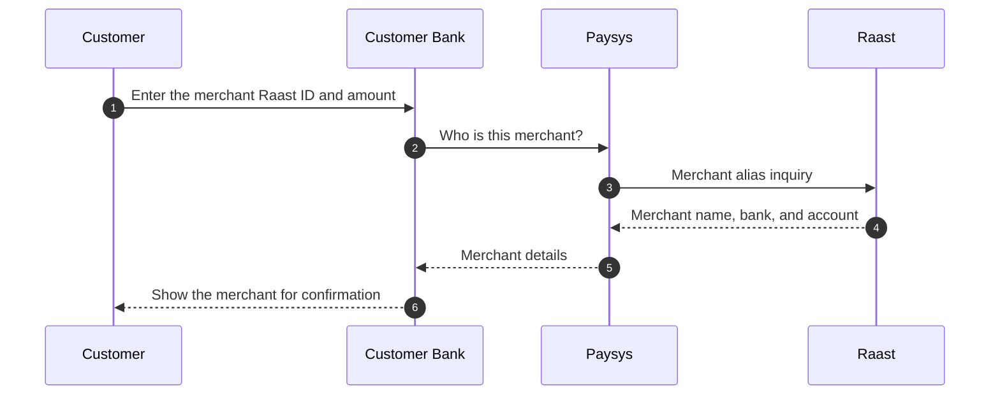

The payment that follows is the same payment as a static QR, in section 3. The merchant bank is expected to answer `pacs.008` with `pacs.002/AUTH`.

---

## 3. Static QR and pay by alias

A static QR already carries the merchant. The customer bank shows the merchant name and category from the QR. The amount is the amount on the QR, or an amount the customer enters. A tip is added when the merchant asked for one. There is no alias inquiry.

Pay by alias reaches this same payment only after the inquiry in section 2.

The customer confirms in the bank's app, using the same approval the bank already uses for a transfer. The bank checks the amount, any tip, and the customer's limits, then asks the core system to hold the funds.

Paysys sends `pacs.008` to Raast. Raast sends it to the merchant's bank. That bank checks the merchant and answers `pacs.002/AUTH`. Raast updates the two banks' positions and sends `pacs.002/ACSP` to both sides.

Paysys marks the payment complete and tells the customer's bank. The bank confirms the debit for the held amount and shows the customer the result.

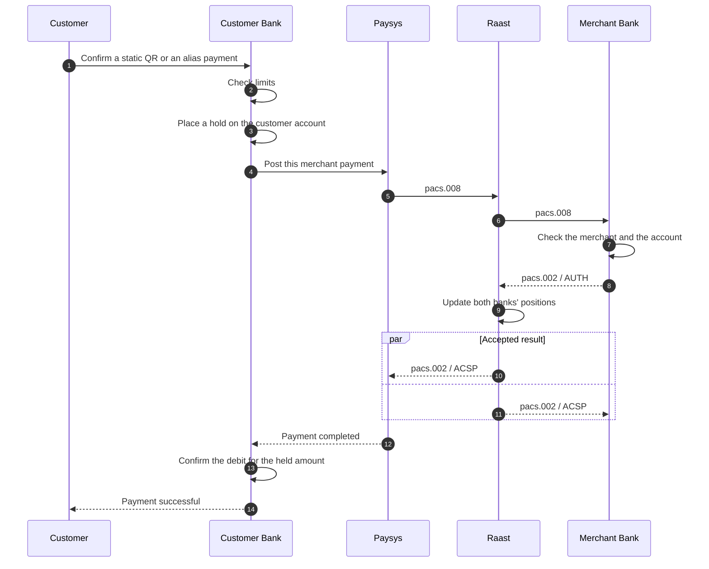

---

## 4. When a static QR or alias payment is rejected

The hold is placed before Raast sees the payment. If the merchant's bank cannot accept it, that bank answers with a decline. Raast sends `pacs.002/RJCT` to both sides. Paysys marks the payment failed, and the customer's bank releases the hold.

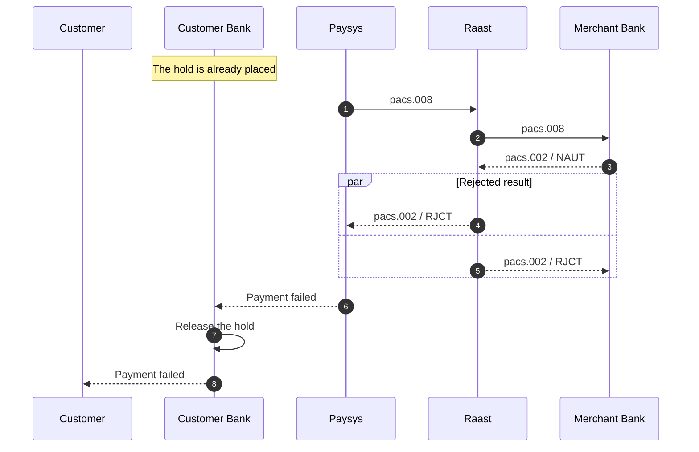

If the core system cannot hold the amount, because the balance is too low or the account is restricted, the bank tells the customer and stops. Paysys is not called. This is true for every flow on this page.

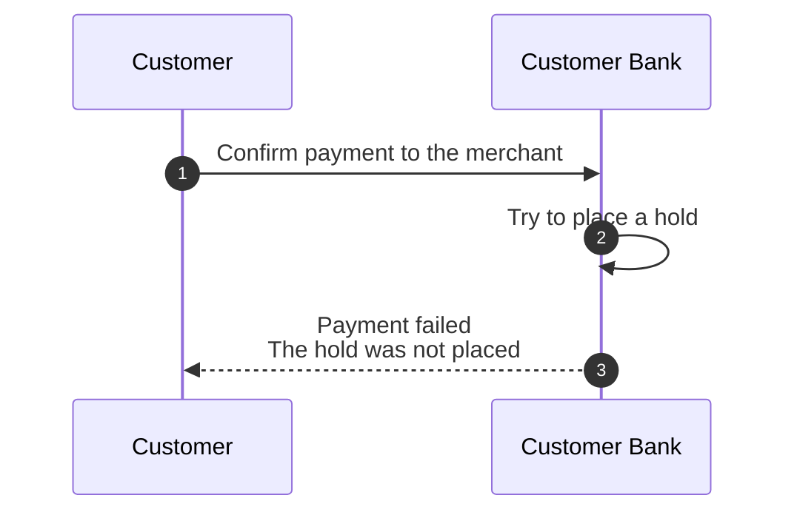

---

## 5. Dynamic QR

A dynamic QR is a request to pay for one bill. The merchant creates that request with Raast before the customer scans. The QR carries the merchant and the request. The customer bank does not inquire on an alias, and Raast does not deliver the request to the customer bank in advance.

The customer scans and confirms. The bank places the hold, and Paysys sends `pacs.008` for that request. Raast checks that the request is still open.

When the request is open, Raast answers the customer bank with `pacs.002/ACSP`. The customer bank confirms the debit. The `pacs.008` the merchant side receives is an advice to credit the merchant. The merchant bank does not answer that advice with `pacs.002/AUTH`.

When the request is not open, Raast answers the customer bank with `pacs.002/RJCT`. The bank releases the hold. There is no decline from the merchant bank on this path.

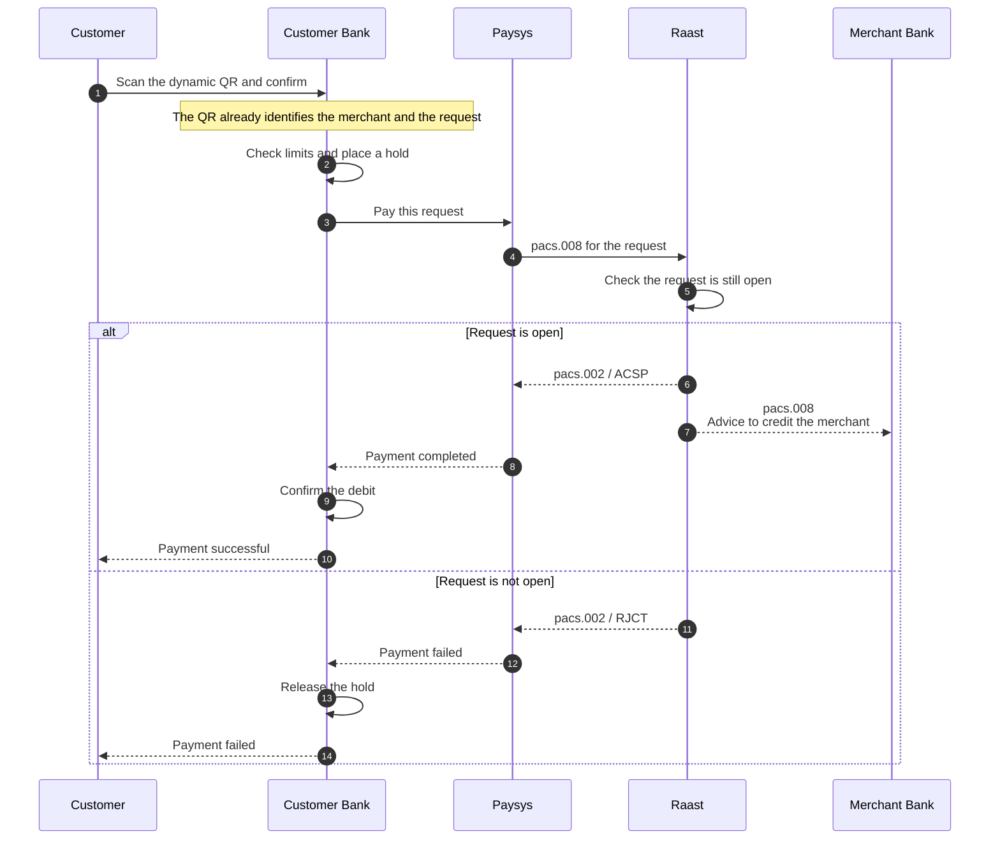

---

## 6. Request to pay, now or later

A merchant can ask the customer to pay without a QR. The merchant looks up the customer's Raast ID, then sends Raast a request to pay. Raast delivers that request to the customer's bank through Paysys. This lookup is the customer's alias. It is not a merchant alias inquiry.

The bank checks that the customer can approve it on a digital channel. If the customer cannot, the bank rejects the request and Raast tells the merchant.

If the customer can approve it, the customer may accept, reject, or block the request.

- **Pay later.** The bank tells Raast that the request was received and the customer will pay before the due date. The merchant is told the same. The money does not move yet.
- **Pay now.** The customer accepts or rejects immediately.

Acceptance, now or later, starts the payment below. It is the dynamic-QR shape: `pacs.008` against the open request, `pacs.002/ACSP` back to the customer bank, and an advice to the merchant side. It is not the `pacs.002/AUTH` payment in section 3.

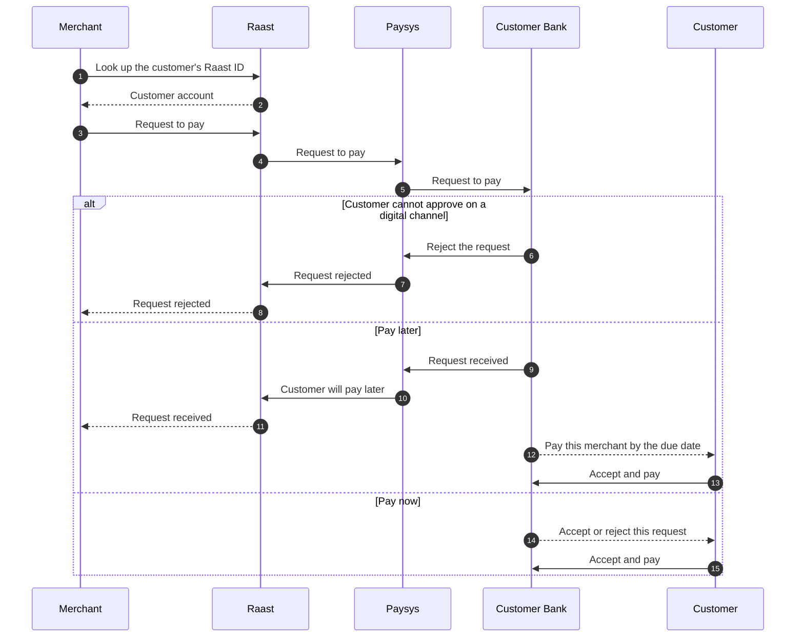

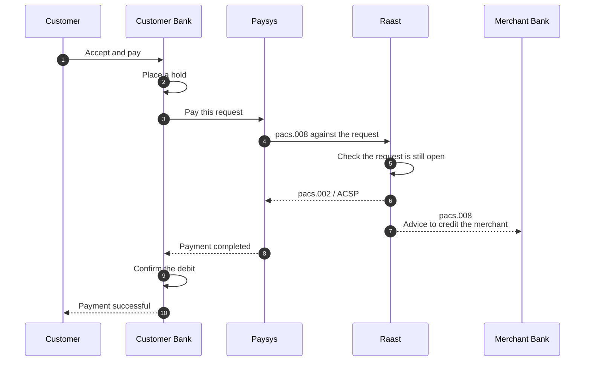

If Raast rejects that payment, the customer bank receives `pacs.002/RJCT` and releases the hold, as in the dynamic QR flow.

---

## 7. Asking for the money back

The customer can ask for a return of the full amount or part of it from the list of merchant payments. The bank checks that the request is within the original amount. Paysys sends the request to Raast, and Raast sends it to the merchant. The merchant decides whether to return the money.

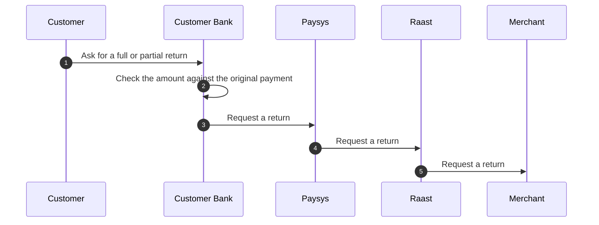

When the merchant does return the money, the merchant sends `pacs.004` for the original payment. Raast confirms that return to the merchant with `pacs.002/ACSP` and sends `pacs.004` to the customer's bank. Paysys asks the bank to credit the customer. The credit is posted so the customer receives the returned amount.

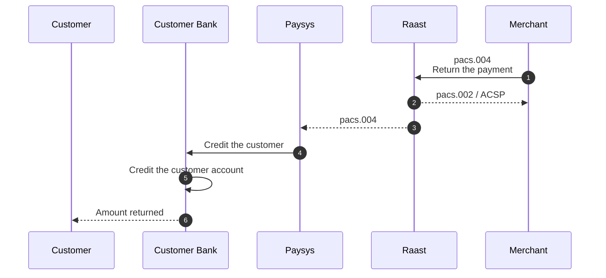

---

## 8. When the result is missing

If the customer's bank does not receive the result in time, it asks Paysys about the original payment. Paysys answers from the status it already stored. If it has no status, it asks Raast with `pacs.028`.

A successful answer confirms the debit. A failed answer releases the hold. The bank then shows the customer the result.

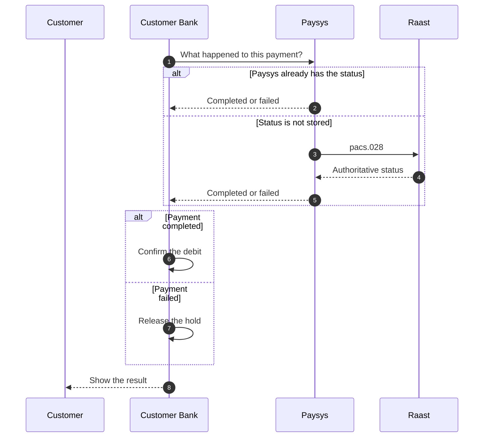

---

## 9. End-to-end mental model

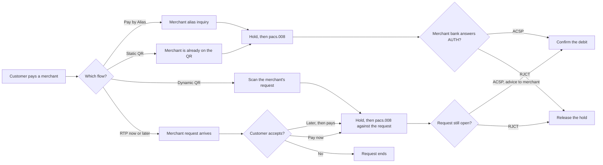

---

## 10. Terms that are specific to this module

Shared message names are defined in Module 1.

| Term | Meaning in this module |
|---|---|
| Customer Service Provider | The customer's bank. It holds the money and confirms the debit |
| Acquiring | The merchant's bank. It checks the merchant and receives the credit |
| Paysys | Open Connect. Posts the customer's payment to Raast and returns the result |
| Direct posting | The customer's bank keeps the debit. Paysys posts the Raast payment |
| Pay by Alias | The customer enters a merchant Raast ID. This flow starts with an alias inquiry, then waits for `pacs.002/AUTH` |
| Static QR | A merchant QR the customer scans. No alias inquiry. `pacs.008` is answered with `pacs.002/AUTH` |
| Dynamic QR | A QR for one request to pay. `pacs.008` on the merchant side is an advice to credit |
| Request to pay | The merchant asks the customer to pay now, or by a later due date. The later payment is checked against that request |

---

## 11. What to remember

1. P2M issuing has four flows: **pay by alias**, **static QR**, **dynamic QR**, and **RTP now or later**.
2. **Pay by alias** is the flow that inquires on the merchant Raast ID. A **static QR** already carries the merchant, so there is no alias inquiry.
3. Static QR and pay by alias send **`pacs.008`** and wait for the merchant bank's **`pacs.002/AUTH`**, then **`pacs.002/ACSP`**. A decline becomes **`pacs.002/RJCT`**, and the bank releases the hold.
4. A **dynamic QR** is a request to pay. Raast checks that request and answers the customer bank with **`pacs.002/ACSP`**. The merchant side receives **`pacs.008` as an advice**, and does not answer it with **`pacs.002/AUTH`**.
5. **RTP now** and **RTP later** use that same request payment once the customer accepts. Pay later only records that the request was received until then.
6. A return the merchant sends is **`pacs.004`**, and the customer's bank credits the account. A missing result is resolved with **`pacs.028`**.
