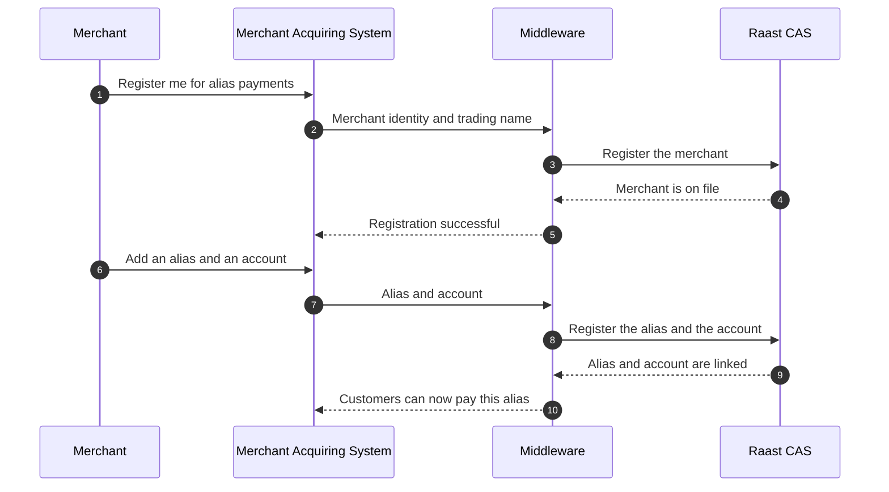
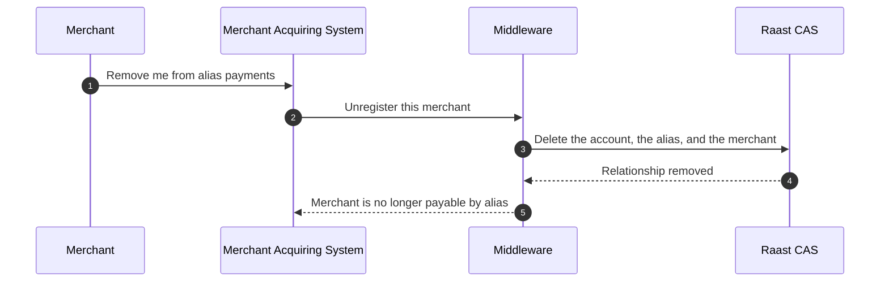
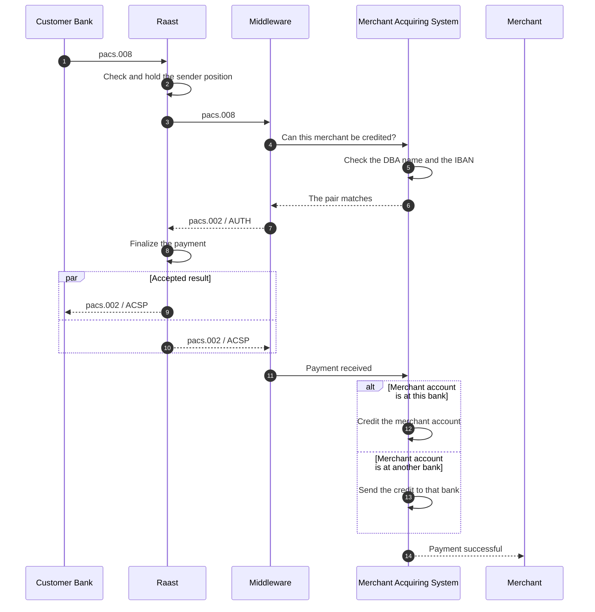
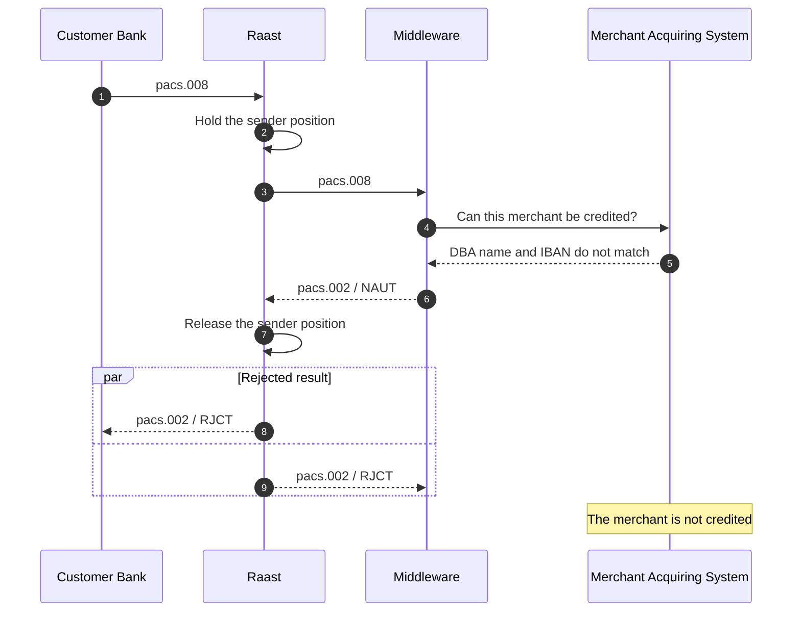
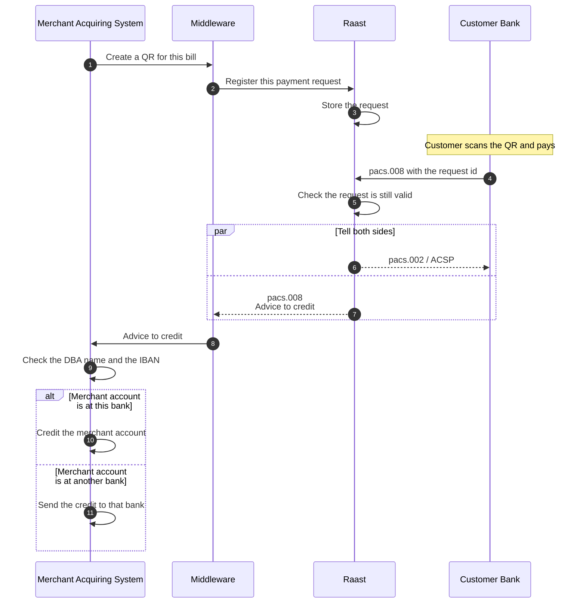
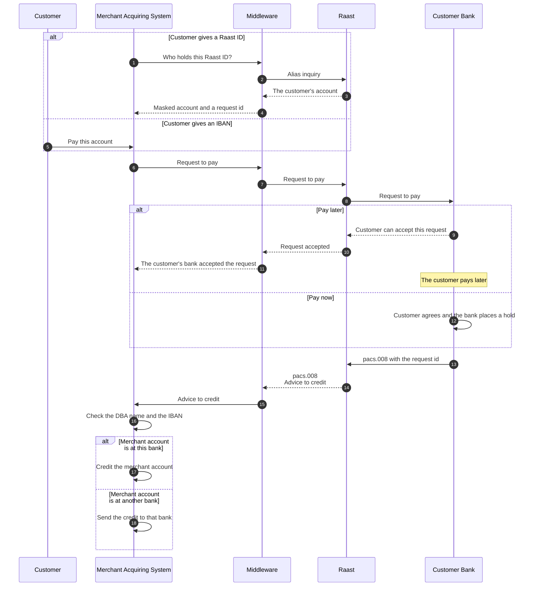
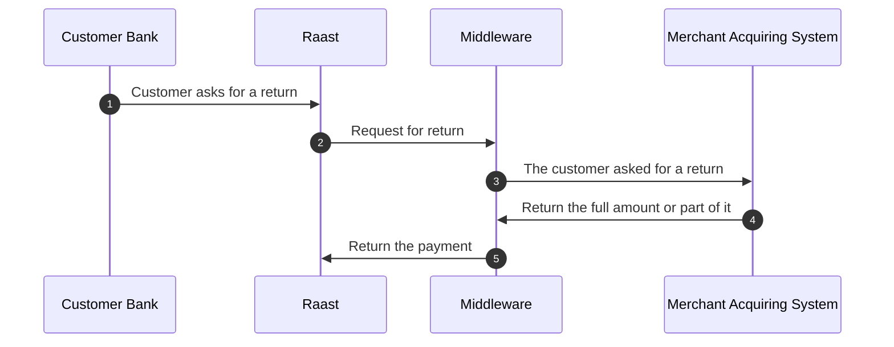
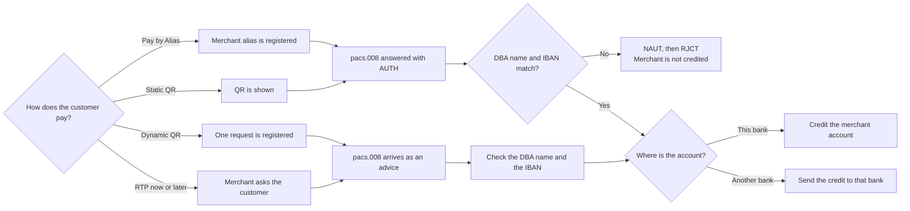

# Module 4 — Raast P2M Acquiring: An Overview

Read [Module 3 — Raast P2M Issuing](../03-p2m-issuing/03_Raast_P2M_Issuing_Overview.md) first. Issuing is the customer's bank paying a merchant. Acquiring is the merchant side receiving that payment.

The Merchant Acquiring System knows the merchant, creates the QR or the request to pay, and credits the merchant after the payment is accepted. Middleware sits between that system and Raast.

P2M has the same four flows as Module 3. A merchant alias is required only for pay by alias, for example a till code. Static QR, dynamic QR, and a request to pay are processed without one.

| Flow | What the merchant side does first | What arrives from Raast |
|---|---|---|
| Pay by Alias | The merchant alias is registered and linked to an account | `pacs.008`, answered with `pacs.002/AUTH` |
| Static QR | The merchant shows a QR. No alias is required | `pacs.008`, answered with `pacs.002/AUTH` |
| Dynamic QR | The merchant registers one request to pay, then shows the QR | `pacs.008` arrives as an advice to credit |
| RTP, now or later | The merchant asks the customer to pay | `pacs.008` arrives as an advice to credit, after the customer pays |

Whenever a payment is received, the Merchant Acquiring System checks that the DBA name and the IBAN are a pair. The merchant account is then credited at this bank, or the credit is sent to the other bank that holds the account.

## Learning objectives

By the end of this module, a new technical employee should be able to:

- Say when a merchant alias is registered, and when a payment does not need one.
- Describe a static QR or pay-by-alias payment, from the DBA and IBAN check to `pacs.002/AUTH`.
- Describe a dynamic QR and a request to pay, where `pacs.008` arrives as an advice.
- Explain the two credit cases: the merchant account is at this bank, or at another bank.
- Explain a decline, a return the merchant sends, and a return that comes back because the credit failed.

---

## 1. What this module adds

The customer journey is in Module 3. This module starts when the merchant is set up, and again when Raast brings a payment to Middleware.

> **Setup answers: “How will this merchant be paid?”**  
> **The incoming payment answers: “Do this DBA name and IBAN belong together, and where is the account credited?”**

`pacs.008`, `pacs.002/AUTH`, `pacs.002/ACSP`, `pacs.002/RJCT`, and `pacs.004` mean the same thing here as in Module 1. Static QR and pay by alias wait for `pacs.002/AUTH`. Dynamic QR and a request to pay deliver `pacs.008` as an advice.

---

## 2. Register a merchant alias

Register an alias when the merchant expects customers to pay by that alias, such as a till code. Static QR, dynamic QR, and a request to pay do not need this registration.

The merchant is registered in the Centralized Alias Service (CAS) through Middleware. The merchant is identified by a merchant CNIC, recorded as MCNIC, or by an NTN. A person already registered as a customer uses MCNIC so the merchant record stays separate.

The alias is what the customer can remember. It can be a merchant ID, a virtual payment address, or a till code. The alias is linked to the merchant account. One account can be marked as the default, so that is the account a lookup returns.

The merchant can link another of its own accounts to the same alias and choose which one is the default. Delinking removes one account from the alias. The alias itself can be activated, suspended, or deleted. Suspending it stops customers paying that alias until it is activated again.

Removing the merchant from alias payments is one step. Middleware asks CAS to delete the account, the alias, and the merchant.

---

## 3. A static QR

The merchant, or an aggregator acting for the merchant, creates a QR and shows it to the customer. The QR can include an amount, or the customer can enter one. Creating this QR does not register a merchant alias.

A multi-use QR stays available for the next customer. A single-use QR carries a reference. The Merchant Acquiring System stores that reference. When the payment arrives, the reference is checked. A reference already paid is not accepted again. After a successful payment, that reference is marked complete.

The customer scan and the debit are the issuing journey in Module 3. Middleware joins the story when Raast delivers the payment.

---

## 4. Incoming static QR or alias payment

The customer's bank sends `pacs.008`. Raast checks the sender's position, holds that position for the amount, and sends the payment to Middleware.

Middleware asks the Merchant Acquiring System whether the merchant can be credited. That system always checks that the DBA name and the IBAN are a pair. A single-use QR is also checked against its reference.

When the check passes, Middleware answers Raast with `pacs.002/AUTH`. Raast finalizes the payment and sends `pacs.002/ACSP` to both sides. Middleware then tells the Merchant Acquiring System. The merchant is notified, and the credit follows one of the two cases below.

- **The merchant account is at this bank.** The Merchant Acquiring System credits that account for the net amount.
- **The merchant account is at another bank.** The credit is sent to that bank.

---

## 5. When the merchant cannot be credited

If the DBA name and IBAN check fails, Middleware answers Raast with `pacs.002/NAUT`. Raast releases the sender position it had held and sends `pacs.002/RJCT` to both sides. The merchant is not credited. This decline is the answer to a static QR or an alias payment. A dynamic QR or a request to pay does not use it, because that `pacs.008` arrives as an advice.

A credit that is accepted and then cannot be posted is returned. Middleware tells the merchant that the payment came back. That return is separate from a return the merchant chooses to send.

---

## 6. A dynamic QR

At a counter or at checkout, the merchant creates a QR for one bill. The Merchant Acquiring System gives that QR a request id. Middleware registers the request with Raast. Raast stores it. This request is not sent to the customer's bank, and it does not require a merchant alias.

The customer scans the QR and pays. Raast checks that the request is still valid, tells the customer's bank the payment is accepted, and sends the merchant side `pacs.008` as an advice to credit. The merchant side does not answer that advice with `pacs.002/AUTH`.

The Merchant Acquiring System still checks the DBA name and the IBAN. It then credits the account at this bank, or sends the credit to the other bank that holds the account. The merchant is notified for the net amount.

---

## 7. Request to pay

Online, the customer can ask the merchant to request the payment instead of scanning a QR. The request can use the customer's Raast ID or the customer's IBAN, and it can be pay now or pay later. The merchant does not need an alias of its own for this flow.

When the customer gives a Raast ID, the Merchant Acquiring System asks Middleware who holds it. Middleware returns a masked account and a request id. The full account stays with Middleware, and that request id is what the merchant sends back. When the customer gives an IBAN, the Merchant Acquiring System sends the request directly.

**Pay now.** Middleware sends the request to Raast. The customer's bank asks the customer. If the customer pays, Raast checks the request and sends `pacs.008` to the merchant side as an advice to credit.

**Pay later.** The customer's bank first confirms the customer can accept the request on a digital channel. Middleware tells the Merchant Acquiring System that the request was accepted. The credit waits until the customer pays. That later payment then arrives as the same advice.

The Merchant Acquiring System checks the DBA name and the IBAN, then credits this bank's merchant account or sends the credit to the other bank.

---

## 8. Returns

A customer can ask for money back. Middleware notifies the merchant of that request. The merchant can return the full amount or part of it. Middleware sends that return to Raast against the original payment. The customer's bank then credits the customer, as described in Module 3.

---

## 9. End-to-end mental model

---

## 10. Terms that are specific to this module

Shared message names are defined in Module 1. The customer side of these payments is defined in Module 3.

| Term | Meaning in this module |
|---|---|
| Merchant Acquiring System | The bank system that holds merchant records, creates QR and payment requests, checks the DBA name and IBAN, and credits the merchant |
| Middleware | The service between the Merchant Acquiring System and Raast |
| DBA name | The merchant name the payment is checked against, together with the IBAN |
| MCNIC | The identification type used when a merchant is registered with a CNIC |
| Merchant alias | A merchant ID, a virtual payment address, or a till code. Required only when customers pay by that alias |
| Default account | The account a lookup returns for that alias |
| Static QR | A QR the merchant can show again. A single-use QR also carries a reference that can be paid once. `pacs.008` is answered with `pacs.002/AUTH` |
| Dynamic QR | A QR for one bill. Raast stores the request, and the later `pacs.008` arrives as an advice |
| Request to pay | The merchant asks the customer to pay now, or the customer's bank first accepts a later payment. The credit arrives as an advice |
| Net amount | The amount credited after the arrangement with the bank is applied |

---

## 11. What to remember

1. Read **Module 3** for the customer paying. This module is the merchant side receiving.
2. A **merchant alias** is for pay by alias, such as a till code. Static QR, dynamic QR, and a request to pay do not need one.
3. Every received payment is checked as a **DBA name and IBAN** pair.
4. Static QR and pay by alias answer **`pacs.008`** with **`pacs.002/AUTH`**. A failed check is **`pacs.002/NAUT`**, then **`pacs.002/RJCT`**.
5. Dynamic QR and a request to pay deliver **`pacs.008` as an advice**. The merchant side does not answer that advice with **`pacs.002/AUTH`**.
6. After the check, the account is credited **at this bank**, or the credit is **sent to the other bank** that holds it.
7. The merchant can return the **full amount or part of it**. A credit that cannot be posted comes back as a return as well.
